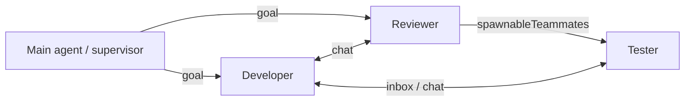

# Pipa

Pipa is an orchestration and execution-discipline package for the
[Pi coding agent](https://github.com/earendil-works/pi).

It extends Pi with structured task execution, decentralized teammates, persistent
project planning, knowledge management, permission guards, and context hygiene.

## Installation

### From npm

```bash
pi install npm:@aelinrezende/pipa
```

To pin a specific version:

```bash
pi install npm:@aelinrezende/pipa@2.3.1
```

### From GitHub

```bash
pi install git:github.com/aelinrezende/pipa
```

### Project installation

Use `--local` to register Pipa in the current project's `.pi/settings.json`:

```bash
pi install --local npm:@aelinrezende/pipa
```

## What Pipa Adds

- Decentralized, persistent teammates with direct collaboration.
- Structured tasks with ownership, dependencies, squads, and lifecycle enforcement.
- Session-level todo lists for small execution steps.
- A persistent project backlog for epics, stories, tasks, and bug fixes.
- A project knowledge base with Markdown documents and fuzzy search.
- Permission guards for terminal commands and direct file modifications.
- Automatic cleanup of noisy model context.
- English and Brazilian Portuguese interface messages.

## An Opinionated Workflow

Most agent orchestrators use a central coordinator. Work flows through one
planner or router, and every sub-agent is created for a single job and then
discarded. That is simple, but it makes the coordinator a bottleneck, and every
handoff loses context.

Pipa takes a different approach: **teammates are decentralized, autonomous, and
persistent.**

### Autonomy

A teammate does not wait for the main agent to approve each step. It claims a
task, works toward the goal it was given, and reports the result. The task guard
keeps this autonomy accountable: teammates must hold an active task before they
can use non-management tools.

### Collaboration without a central router

Teammates can talk to each other directly.

- `teammates → chat` opens a synchronous conversation with another teammate by ID. It is the default for status checks, validation, and adjustments.
- `teammates → send-inbox` leaves an asynchronous message for a teammate who is busy and should not be interrupted.
- `spawnableTeammates` lets a teammate delegate to specific specialists, each with a stated reason. A reviewer can call a developer for a correction or a tester for more validation without going back to the main agent.

The main agent stays the supervisor. It can instantiate any teammate, but it is
not on the critical path of every exchange.

### Teammates that stay while they are useful

Teammates are not disposable workers. Once a teammate has context about the
codebase, the task history, and earlier decisions, its session stays available.

- The `online` action shows which teammates have an active session.
- A teammate is released only through `dismiss`, with an explicit reason, once it is no longer needed.
- Optional session compaction after task actions keeps long-lived teammates from filling their own context.



| | Centralized orchestration | Pipa |
| --- | --- | --- |
| Coordination | Everything goes through one coordinator | Direct teammate-to-teammate chat and inbox |
| Teammate lifetime | Created per request, then discarded | Session kept online until dismissed |
| Delegation | Only the coordinator delegates | Teammates delegate through `spawnableTeammates` |
| Accountability | Depends on the coordinator | Task claims, dependencies, and lifecycle enforcement |

## Tools

| Tool | Purpose | Main actions |
| --- | --- | --- |
| `task` | Manage operational work assigned to agents | `instantiate`, `setup`, `claim`, `update`, `get`, `list` and further lifecycle actions |
| `teammates` | Discover, start, communicate with, and dismiss teammates | `instantiate`, `list`, `online`, `chat`, `send-inbox`, `read-inbox`, `dismiss` |
| `todo` | Track small execution steps inside the current workflow | `instantiate`, `update`, `remove`, `list`, `clear` |
| `backlog` | Manage persistent project work | `instantiate`, `list`, `select`, `update-frontmatter`, `update-body`, `update-metadata`, `remove` |
| `docs` | Maintain the project knowledge base | `instantiate`, `list`, `select`, `update-frontmatter`, `update-body`, `update-metadata`, `remove`, `publish` |

## Task Execution

A task can contain a short name, a detailed description, hard or soft
dependencies, a parent task, and a squad.

Dependencies can be:

- `hard`: completely blocks execution until the dependency is completed.
- `soft`: records an informational dependency without blocking execution.

Teammates must claim an active task before calling non-management tools. The
`task`, `teammates`, and `todo` tools remain available so an agent can organize
its work and recover from a missing task. The main agent acts as the supervisor
and is not subject to this guard.

## Teammates

Teammates are specialized local agents defined through Markdown files. Pipa loads
teammates bundled with the package and project teammates stored in
`.pi/teammates/`.

Before delegating work, an agent can list the available teammates. A teammate is
instantiated with a concrete goal containing the necessary context, constraints,
and acceptance criteria.

### Teammate definition

Create a Markdown file such as `.pi/teammates/reviewer.md`:

```markdown
---
name: reviewer
description: Reviews implementations, verifies requirements, and identifies risks.
thinking: medium
spawnableTeammates:
  developer: Requests implementation corrections
  tester: Requests additional validation
---

You are a senior software reviewer.

Review the assigned artifact against its requirements. Identify correctness
issues, missing validation, architectural risks, and unnecessary complexity.

Return actionable findings ordered by severity.
```

Supported frontmatter fields:

| Field | Required | Description |
| --- | --- | --- |
| `name` | Yes | Unique lowercase identifier used to invoke the teammate |
| `description` | Yes | Short explanation of the teammate's role |
| `thinking` | No | Thinking level used by the teammate |
| `spawnableTeammates` | No | Teammates this teammate may instantiate, with the reason for each delegation |

The main agent can instantiate any teammate. Other teammates can instantiate only
themselves or teammates listed in `spawnableTeammates`.

### Model concurrency

Pipa can distribute teammates across candidate models to avoid sending every
parallel agent through the same model queue. Model cycling can be triggered by
`error` or `concurrency` events and is controlled through `pipa.config.ts`.

## Todo Lists

The `todo` tool tracks small steps within the current execution flow. Items
support the statuses `pending`, `in_progress`, and `completed`. Use `todo` for
short checklists, `task` for delegated work, and `backlog` for persistent
project planning.

## Project Backlog

The `backlog` tool maintains persistent project work as Markdown documents with
structured metadata.

- Item types: `epic`, `story`, `task`, `bugfix`.
- Priorities: `low`, `medium`, `high`, `critical`.
- Items can have a title, Markdown body, status, domains, tags, a parent item, and arbitrary JSON metadata.

The tool supports filtering, sorting, selection by title, code, or tags, metadata
updates, body updates, and removal.

## Project Documentation

The `docs` tool maintains a local Markdown knowledge base. Documents support
titles, short summaries, tags, parent-child relationships, Markdown content,
arbitrary metadata, fuzzy search, sorting, and filtering.

The `publish` action exports the documents to Markdown and generates a static
site.

## Permissions and Guardrails

Pipa adds guardrails around tool execution, but it is not a security sandbox.

- Terminal commands are validated against a command policy, and commands classified as dangerous are blocked.
- The main agent must get confirmation before directly using `edit` or `write`.
- Teammates must claim an active task before using non-management tools.

These checks complement Pi's own security model. They do not replace operating
system permissions, repository protections, isolated environments, or human
review.

## Context Hygiene

Long-running agent workflows can accumulate blocked calls and stale messages.
When a tool call is blocked because no task is active, Pipa collapses the repeated
attempts into a single notice so the model context stays clean.

## Configuration

Create `.pi/pipa.config.ts` in the project. Every option is optional.

```typescript
export default {
  // Interface and agent-message language: 'en' or 'pt-BR'.
  locale: 'en',

  // Persist teammate messages.
  persistMessages: false,

  teammate: {
    // How a teammate processes an incoming nudge.
    nudgeMode: 'steer',

    // Hide teammate tool calls from the terminal interface.
    hideTools: false,

    // Hide the model name used by teammates.
    hideModelName: false,

    // Models allowed to run concurrently.
    concurrentlyModels: [],

    cycling: {
      // Events that trigger model rotation: 'error' and/or 'concurrency'.
      events: [],

      // Candidate model IDs used during rotation.
      models: []
    },

    // Compact the teammate session after a task action.
    compactAfterTaskAction: false
  },

  tasks: {
    // Maximum number of tasks displayed simultaneously in the TUI.
    maxVisible: 5
  }
};
```

Project configuration is merged over the defaults above. Arrays replace the
corresponding default array instead of being concatenated.

## Localization

Pipa supports `en` (English) and `pt-BR` (Brazilian Portuguese). Set `locale` in
`.pi/pipa.config.ts`.

## Package Contents

The distributed Pi package includes the compiled Pipa extension, skills, prompt
templates, teammate definitions, and resource templates.

## Distribution

The `aelinrezende/pipa` repository contains generated distribution artifacts. The
source implementation is maintained in `pipa-source`. Releases build the
extension and publish the result to GitHub and npm. Do not edit the distribution
repository directly.

## License

Pipa is licensed under the MIT License.
