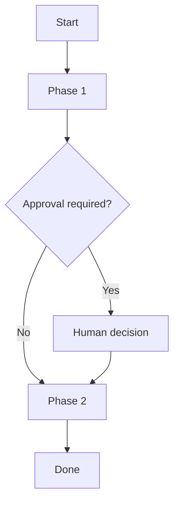

# Skill Template

Use this template to create a domain-specific skill under `.pi/skills/<name>/SKILL.md`. Write it in the language selected during onboarding.

````markdown
---
name: SKILL_NAME
description: Explain when this skill should be activated and what outcome it produces.
---

# [Skill title]

## Purpose

[Describe the skill's role in the configured domain, expected inputs, and expected outputs.]

## Operating Phases

### 1. [Phase name]

- [What must happen.]
- **Delegation:** [Which teammate or role should own specialist work, if applicable.]
- **Human interaction:** [When the workflow must stop for user input or approval.]

### 2. [Phase name]

- [Next actions, evidence, and transition conditions.]

## Human-in-the-Loop

- [Decisions and risk boundaries that require explicit human approval.]

## Strict Rules

- [Constraints that cannot be violated in this domain.]
- [Required validation and artifact rules.]

## Completion Criteria

- [How to determine that the skill outcome is complete and acceptable.]

## Visual Flow



## Examples

- **Expected input:** [Domain-relevant example.]
- **Expected output:** [Deliverable and format.]
````
